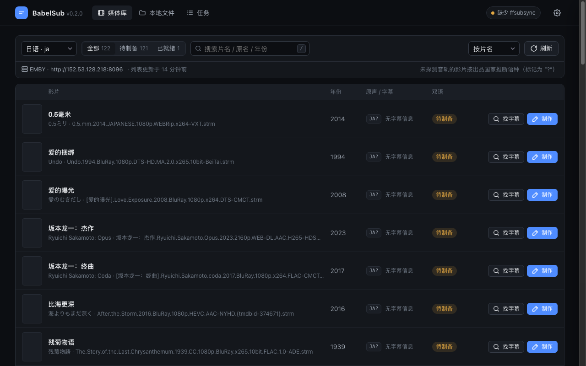

# BabelSub

BabelSub 是一个专为语言学习（如看原声日影、美剧学外语）设计的双语字幕处理工具。

写这个工具的初衷是因为自己在 Infuse / Emby 看外语片时，经常找不到舒服的双语字幕：
- 播放器内置刮削下的外挂字幕经常和原盘帧率对不上，时间轴越播越偏；
- 网盘（如 115 / CloudDrive2）直接全盘扫描极易触发限流风控；
- 学习外语时需要原声语言在上、中文在下，但很多现成双语字幕排版字体要么巨大遮挡屏幕，要么比例不合适。

BabelSub 通过对接 Emby / Jellyfin / Plex 的 API 快速读取库内影片信息（无需扫盘），自动获取或导入现有单语字幕，利用 `ffsubsync` 以前期原声字幕（或音频）为基准将中文字幕对齐，最后拼合成标准排版的双语 ASS 字幕写回目录。

> **关于字幕内容的说明**：  
> 本工具仅负责字幕时间轴的对齐、缝合与排版输出，字幕文本内容均来自公开网络源或原盘自带轨。字幕本身的翻译质量取决于原作者或抓取源，工具本身不做翻译背书，仅供语言学习参考。

---

## 功能特性

- **零扫盘**：仅通过 Emby/Jellyfin/Plex API 读取电影信息，不遍历挂载盘文件树，避免 115 / 网盘限流。
- **自动对轴**：基于 `ffsubsync`，用原语言字幕作为黄金参考基准，自动修正中文字幕的偏移和帧率拉伸。
- **正常排版**：固定 1080p 画布基准（`PlayResX: 1920` / `PlayResY: 1080`），原语言大字、中文微缩居下，适配 Infuse 等播放器。
- **即时刷新**：生成 `.zh-ja.ass` / `.zh-en.ass` 写回电影目录后，调用 API 通知媒体库局部刷新，Infuse 打开即可选择。
- **直接处理 MKV / MP4**：用 ffprobe 读取内嵌音轨与字幕轨（STRM 指向的直链也只读文件头），可直接用内嵌文本字幕轨制作双语字幕，无需媒体服务器。
- **自带 Web 界面**：媒体库分页浏览、在线检索字幕、选择字幕来源后一键制作，任务在后台排队执行；也可以浏览本机文件夹处理本地视频。



---

## 依赖要求

- **ffmpeg / ffprobe** (用于读取媒体轨道、提取内嵌字幕或音频对轴，请确保在系统 PATH 中或在设置中指定)
- 若使用下方的预编译全功能包，**无需**安装 Python 与 ffsubsync（已内置封装独立的对轴引擎）。

---

## 安装使用

### 方式一：下载开箱即用全功能包（推荐）
直接在 [Releases](https://github.com/Gawain12/BabelSub/releases) 页面下载对应系统的压缩包：
- `babelsub-darwin-arm64.tar.gz` (macOS Apple Silicon)
- `babelsub-linux-amd64.tar.gz` (Linux x86_64)
- `babelsub-linux-arm64.tar.gz` (Linux ARM64)
- `babelsub-windows-amd64.zip` (Windows x64)

压缩包内已打包好 `babelsub` 与独立的 `ffsubsync` 可执行程序，解压后即可直接使用，免除任何 Python 环境配置。

- **仍需自行安装 ffmpeg**（读取 MKV 轨道、转换 ASS/VTT 字幕时使用）：macOS `brew install ffmpeg`，Debian/Ubuntu `apt install ffmpeg`，Windows 可用 `winget install ffmpeg`。
- **macOS 首次运行**：程序未经 Apple 公证，浏览器下载后会被系统拦截，解压后在该目录执行一次：
  ```bash
  xattr -dr com.apple.quarantine babelsub ffsubsync
  ```

### 方式二：一键脚本（macOS / Linux）
```bash
./scripts/install.sh
```

### 方式三：手动编译
```bash
# 1. 准备 Python 虚拟环境并安装 ffsubsync
python3 -m venv ~/.config/babelsub/venv
~/.config/babelsub/venv/bin/pip install ffsubsync

# 2. 编译二进制
go mod tidy
go build -o bin/babelsub ./cmd/babelsub
```

---

## 使用指南

### 1. 配置服务器（初次使用）
配置你的媒体服务器连接，信息会保存在 `~/.config/babelsub/config.yaml`：
```bash
# Emby 示例
./bin/babelsub config --type emby --host http://192.168.1.100:8096 --token YOUR_API_KEY

# Plex 示例
./bin/babelsub config --type plex --host http://192.168.1.81:32400 --token YOUR_PLEX_TOKEN
```

### 2. 扫描库内电影
```bash
# 查看所有日语原声电影
./bin/babelsub scan --lang ja

# 仅列出尚未制作双语字幕的电影
./bin/babelsub scan --lang ja --missing-only
```

### 3. 检索公开字幕
```bash
./bin/babelsub fetch --query "Swing Girls"
```

### 4. 查看视频内的轨道
```bash
# 列出音轨、字幕轨（标明能否提取）以及同目录同名外挂字幕；也支持 http 直链
./bin/babelsub probe ~/Movies/Swing.Girls.2004.mkv
```

### 5. 对轴并合并双语字幕
字幕来源可以是 `.srt / .ass / .ssa / .vtt` 文件、URL，或视频里的内嵌文本字幕轨：
```bash
# 两个字幕文件：以原语字幕为基准对齐中文字幕
./bin/babelsub merge --ref ja.srt --in zh.ass --out movie.zh-ja.ass

# 直接用 MKV 里的两条内嵌轨道（同一文件内默认不对轴），输出到视频旁 movie.zh-ja.ass
./bin/babelsub merge --media movie.mkv --ref-track 2 --in-track 3

# 两条外部字幕都不同步时，以视频音轨为基准对轴
./bin/babelsub merge --media movie.mkv --ref ja.srt --in zh.srt --sync video
```

### 6. Web 控制台
```bash
./bin/babelsub --port 18980            # 仅本机使用可加 --listen 127.0.0.1
```
浏览器打开 `http://localhost:18980`：
- **媒体库**：按语种 / 状态 / 关键词筛选，分页浏览；点开影片可查看文件位置与轨道、用 ffprobe 读取直链轨道、检索在线字幕，并选择上下两条字幕来源制作双语字幕。
- **本地文件**：浏览本机文件夹（只读取当前这一层目录），选择视频后自动读取内嵌轨道和同名外挂字幕；不选视频也可以直接合并两个字幕文件。
- **任务**：查看排队 / 进行中 / 已完成的任务、日志，下载生成的 ASS。
- **设置**：服务器、默认语种、路径映射、字幕样式（带预览）、ffmpeg / ffsubsync 路径。

### 路径映射
媒体服务器里的路径（如 `/Movies/...`）在本机通常挂载在别处。配置映射后，BabelSub 才能把字幕写回影片目录并通知媒体库刷新；未配置时可以选择「仅生成，下载到本机」。
```bash
./bin/babelsub config --type emby --host http://192.168.1.100:8096 --token KEY --map /Movies=/Volumes/CloudDrive/115/Movies
```

---

## 配置文件示例

文件路径：`~/.config/babelsub/config.yaml`

```yaml
server:
  type: emby                    # emby / jellyfin / plex
  host: http://192.168.1.100:8096
  token: your_api_key_here

styling:
  play_res_x: 1920              # 1080p 画布宽度
  play_res_y: 1080              # 1080p 画布高度
  font_name: Arial
  primary_font_size: 44         # 上层主语言字号
  secondary_font_size: 30       # 下层中文辅助字号
  primary_color: "&H00FFFFFF"   # 白色
  secondary_color: "&H00D0FFFF" # 淡金/淡黄
  margin_v: 35                  # 底部边距

language:
  target_audio: ja              # 默认筛选的原声音轨
  native_sub: zh                # 默认母语字幕语言

ffsubsync_bin: ffsubsync        # 可指定绝对路径，如 ~/.config/babelsub/venv/bin/ffsubsync
ffmpeg_bin: ""                  # 留空自动查找
ffprobe_bin: ""

path_mappings:                  # 服务器路径前缀 -> 本机路径前缀
  - from: /Movies
    to: /Volumes/CloudDrive/115/Movies
```

---

## License

[MIT](LICENSE)
